# Calorimeter studies with cosmics, run 125329

Input: `/exp/mu2e/data/users/pgirotti/ntuples/mc2/calibrated/ntuple_run125329.root` (`EventNtuple/ntuple`), 10,325,014 events, 10.8 h of cosmic running.

The ntuple contains, from highest to lowest level:

- `caloclusters`: clusters with a 10 MeV threshold and disk-local COG coordinates
- `calohits`: crystal hits, down to about 0.5 MeV
- `calorecodigis`: fitted pulses, one per SiPM
- `calodigis`: raw SiPM waveforms

Each event reads out about 100 µs.

## Summary

1. **Time offsets on some SiPMs.** In 283 crystals, the reconstructed time of one SiPM, or of both together, is off by a whole number k of ~169 ns steps (k from −7 to +7). The raw waveforms of the two SiPMs line up; the shift appears only after reconstruction. The likely cause is wrong per-SiPM time-calibration constants.
   - The two SiPMs of an affected crystal are then not merged into one hit. The late SiPM forms a second, "echo" cluster.
   - That produces the spikes at fixed delays (0.17–1.18 µs) in every Δt distribution.
   - About 780 more crystals have their two SiPMs 5–10 ns apart, which is often too far for the hit builder to merge them.
   - Together these explain why 57% of hits have only one SiPM.
   - A correction table per SiPM is provided.
2. **Stopped-muon lifetime.** τ = 2.117 ± 0.008 µs (single exponential fitted from 1.25 µs). τ rises as the fit start moves later. A μ⁺ + second-component fit finds τ₂ = 1.44 ± 0.22 µs carrying 9.5% of the decays, which fits μ⁻ stopping in light materials. **Superseded by section 9:** with corrected hit tracks, τ = 2.201 ± 0.015 µs.
3. **Michel spectrum.** The edge is at E₀ = 38.80 ± 0.23 MeV with σ = 6.18 ± 0.13 MeV (90k decays). It is not directly comparable to the slide value, because the clustering threshold differs.
4. **μ⁻ capture in CsI (τ ≈ 70–80 ns) is not observed.** That holds for clusters, for hits, and after correcting the SiPM times. For about 1 µs after every muon, crystals across the disk show an excess of mostly soft hits, 40–300 times the accidental rate. The excess doesn't depend on distance from the muon and buries any capture signal.
5. **Calibration and stability.**
   - The MIP peak is 21.4 MeV per crystal, uniform to 3%, and stable to 0.5% over the run.
   - The time resolution per crystal is about 0.8 ns at 15–20 MeV.
   - The two SiPMs of a crystal agree in gain to about 5%.
   - At subrun 561 the event rate drops by 7% with no change in calorimeter activity, which points to a trigger or readout change. Subruns 121–131 are missing.

## Code

All scripts run with `/cvmfs/mu2e.opensciencegrid.org/env/ana/current/bin/python`. Times below are on a 4-core node.

| Script | Reads | Writes | Purpose |
|---|---|---|---|
| [fill_calo.py](fill_calo.py) | ntuple | `calo_run125329.npz` | Cluster and hit histograms, plus all prompt/delayed cluster pairs (about 80 s) |
| [plot_calo.py](plot_calo.py) | `calo_*.npz` | plots 01–13, 16 | Lifetime, Michel and cluster/crystal QA plots; cluster-level capture view |
| [event_display.py](event_display.py) | ntuple, `calo_*.npz` | `event_display/` | Displays of 10 random decay candidates |
| [fill_capture.py](fill_capture.py) | ntuple | `capture_run125329.npz` | Hit-level capture search, uncorrected (about 5 min) |
| [plot_capture_hits.py](plot_capture_hits.py) | `capture_*.npz` | plot 14 | |
| [sipm_offsets.py](sipm_offsets.py) | ntuple | `sipm_offsets_run125329.npz` | Time offset between the two SiPMs of each crystal |
| [echo_study.py](echo_study.py) | ntuple, offsets | plot 15, `sipm_offsets_k.txt` | Echo / SiPM-offset figure |
| [sipm_abs_offsets.py](sipm_abs_offsets.py) | ntuple, `sipm_offsets_k.txt` | `sipm_abs_offsets_run125329.npz`, `…_shifted.txt` | Absolute offset of each SiPM (iterative, 3 passes, about 3 min) |
| [fill_sipm.py](fill_sipm.py) | ntuple | `sipm_run125329.npz` | SiPM timing and gain balance, run stability (about 2 min) |
| [plot_sipm.py](plot_sipm.py) | `sipm_*.npz` | plots 17–18 | |
| [fill_capture2.py](fill_capture2.py) | ntuple, absolute offsets | `capture2_run125329.npz` | Hit-level capture search with SiPM times corrected |
| [plot_capture2.py](plot_capture2.py) | `capture2_*.npz` | plot 19 | |
| [fill_stops.py](fill_stops.py) | ntuple, `calo_*.npz`, absolute offsets | `stops_run125329.npz` | Stopped-muon candidates from SiPM-corrected hit tracks, and the hit groups around them (about 2 min) |
| [wf_template.py](wf_template.py) | ntuple | `wf_template_run125329.npz` | SiPM pulse template from data, 0.5 ns grid (about 7 min) |
| [fill_wfcapture.py](fill_wfcapture.py) | ntuple, stops, template | `wfcapture_run125329.npz` | Two-pulse fits to the stop crystal's raw waveforms, with embedding (about 45 min) |
| [plot_stops.py](plot_stops.py) | stops, wfcapture | plots 20–25 | Stop purity, lifetime, low-energy Michel spectrum, asymmetry, delayed soft activity, waveform capture search |

```bash
PY=/cvmfs/mu2e.opensciencegrid.org/env/ana/current/bin/python
NT=/exp/mu2e/data/users/pgirotti/ntuples/mc2/calibrated/ntuple_run125329.root
$PY fill_calo.py $NT calo_run125329.npz 3
$PY plot_calo.py calo_run125329.npz plots_run125329
$PY sipm_offsets.py $NT sipm_offsets_run125329.npz 2000000
$PY echo_study.py $NT sipm_offsets_run125329.npz calo_run125329.npz plots_run125329
$PY sipm_abs_offsets.py $NT plots_run125329/sipm_offsets_k.txt sipm_abs_offsets_run125329.npz 3000000
$PY fill_sipm.py $NT plots_run125329/sipm_offsets_k.txt sipm_run125329.npz 3
$PY plot_sipm.py sipm_run125329.npz plots_run125329/sipm_offsets_k.txt plots_run125329
$PY fill_capture.py $NT capture_run125329.npz 3
$PY plot_capture_hits.py capture_run125329.npz plots_run125329
$PY fill_capture2.py $NT sipm_abs_offsets_run125329.npz capture2_run125329.npz 3
$PY plot_capture2.py capture2_run125329.npz plots_run125329
$PY event_display.py $NT calo_run125329.npz plots_run125329/event_display 10 1
$PY fill_stops.py $NT stops_run125329.npz 4
$PY wf_template.py $NT wf_template_run125329.npz 60000
$PY fill_wfcapture.py $NT stops_run125329.npz wf_template_run125329.npz wfcapture_run125329.npz 4
$PY plot_stops.py stops_run125329.npz plots_run125329 wfcapture_run125329.npz
```

### Cluster pairs and cuts

Every pair of clusters on the same disk with 20 ns < Δt < 25 µs and a COG separation ΔR < 150 mm is a candidate. Each delayed cluster is kept once, paired with the earlier cluster closest to it in space. The analysis then applies these cuts:

| Cut | Value |
|---|---|
| ΔR between COGs | < 80 mm |
| E_delayed for the lifetime fit | < 60 MeV |
| Lifetime fit range | 1.25–20 µs, in 0.25 µs bins |
| Michel signal window | 1.25–10 µs |
| Michel sideband | 11–20 µs, scaled by 0.972 |

The slides start at 1 µs. Every window here starts at 1.25 µs instead, because the last echo spike sits at 1.18 µs.

## 1. SiPM time offsets and echo clusters

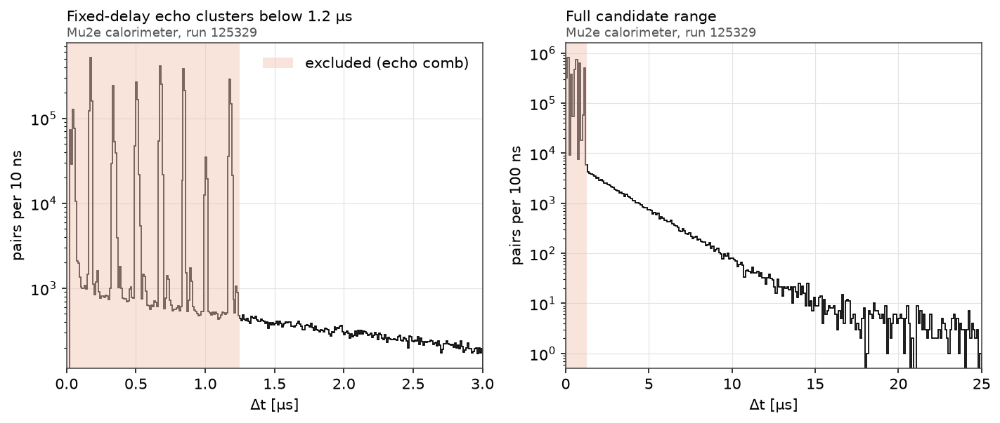

Below 1.2 µs the pair Δt distribution has narrow spikes, up to 10⁶ pairs per 10 ns. They sit at multiples of about 169 ns: 0.17, 0.33, 0.51, 0.68, 0.85, 1.01 and 1.18 µs.

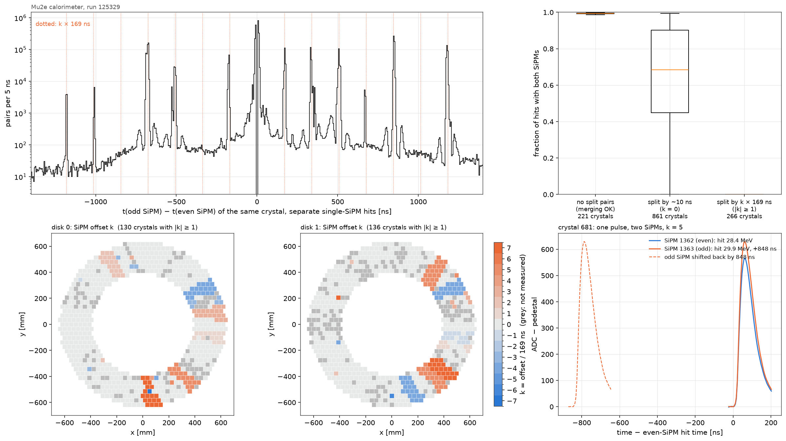

- **An echo is the crystal's other SiPM.** Each crystal has two SiPMs. In 21k spike pairs the echo cluster shares crystals with the prompt cluster, but never a SiPM. In crystals where the two SiPMs fired as separate hits, their time difference has a fixed value per crystal, either k × 169 ns or about ±10 ns (top panel).
- **The shift is added in reconstruction.** Panel (e) shows crystal 681: the two raw waveforms line up, yet the reconstructed times are 848 ns (k = 5) apart. Over 200k split pairs, the raw digitizer peak times differ by 0 in most groups (±1 step in a few). So the offset comes from reconstruction, most likely from per-SiPM time-calibration constants.
- **The affected crystals form patches.** They come in runs of 2–4 consecutive crystal IDs with the same k, which form contiguous areas on the disks (maps). That fits a grouping by readout board, but the channel map is needed to confirm it.
- **Two classes of crystals.**
  - Crystals with a whole-step shift almost never have a two-SiPM hit.
  - Crystals with a 5–10 ns split merge their two SiPMs only 68% of the time. The hit builder's merge window looks narrower than these offsets.

**Correction table.** `sipm_abs_offsets.py` measures each SiPM's offset against reference crystals: hits that merge both SiPMs, within 120 mm on the same disk. It runs several passes, so SiPMs measured in one pass serve as references in the next and the calibration reaches regions with no good crystals. Result: [sipm_abs_offsets_run125329_shifted.txt](sipm_abs_offsets_run125329_shifted.txt) lists 320 entries in 283 crystals: 190 even SiPMs, 102 odd SiPMs, and 28 crystals where both SiPMs are shifted by the same step. In those 28 crystals the merged hits look normal but are at the wrong time; the relative method cannot see them. The earlier relative list (`plots_run125329/shifted_sipms.txt`) is superseded: only 196 of its 237 calls agree with the absolute measurement.

After the correction, with split pairs merged and echo clusters excluded as prompts, the largest spike between 100 and 1300 ns drops from 700–1400× the local baseline to 30–60×. The remaining spikes (±175, ±510, ±850 ns) are mostly merged hits in crystals that still lack an offset measurement for their merged hits.

## 2. Stopped-muon lifetime

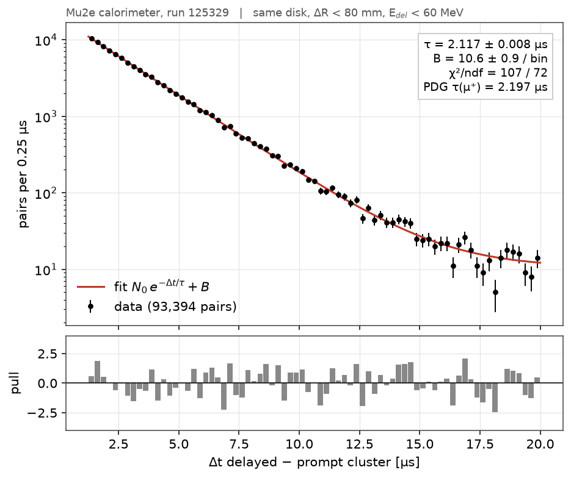

| | Value |
|---|---|
| Pairs in the fit | 93,394 |
| τ (single exponential + flat background) | **2.117 ± 0.008 µs** |
| χ²/ndf | 107 / 72 |
| PDG τ(µ⁺) | 2.197 µs |

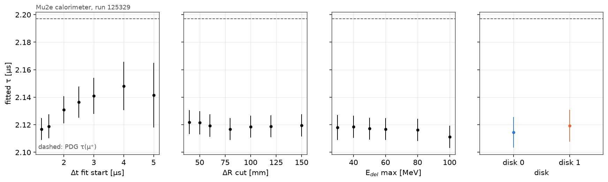

τ does not depend on the ΔR cut, the E_delayed cut or the disk. It does rise with the fit start: 2.117 (1.25 µs), 2.131 (2 µs), 2.141 (3 µs), 2.148 ± 0.018 (4 µs).

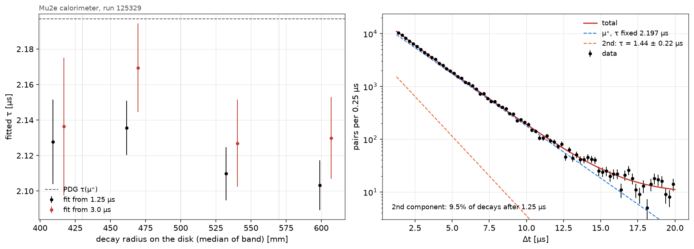

- **No dependence on position.** τ is the same in four radial bands (2.10–2.14 µs).
- **Two-component fit.** With the μ⁺ lifetime fixed at 2.197 µs, a second component has τ₂ = **1.44 ± 0.22 µs** and makes up **9.5%** of decays after 1.25 µs. That lies between the μ⁻ lifetimes in carbon (2.03 µs) and aluminium (0.86 µs), so a mix of light support materials would fit. The material is not identified here.
- **Effect of the echoes.** Echo copies shift a pair's Δt by a fixed amount, which doesn't change an exponential's slope, so the lifetime isn't biased.

## 3. Michel spectrum

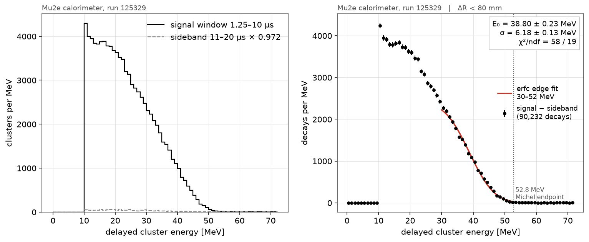

| | All | Disk 0 | Disk 1 |
|---|---|---|---|
| Decays | 90,232 | 46,268 | 43,963 |
| E₀ [MeV] | **38.80 ± 0.23** | 39.36 ± 0.30 | 38.15 ± 0.37 |
| σ [MeV] | **6.18 ± 0.13** | 6.01 ± 0.18 | 6.36 ± 0.20 |

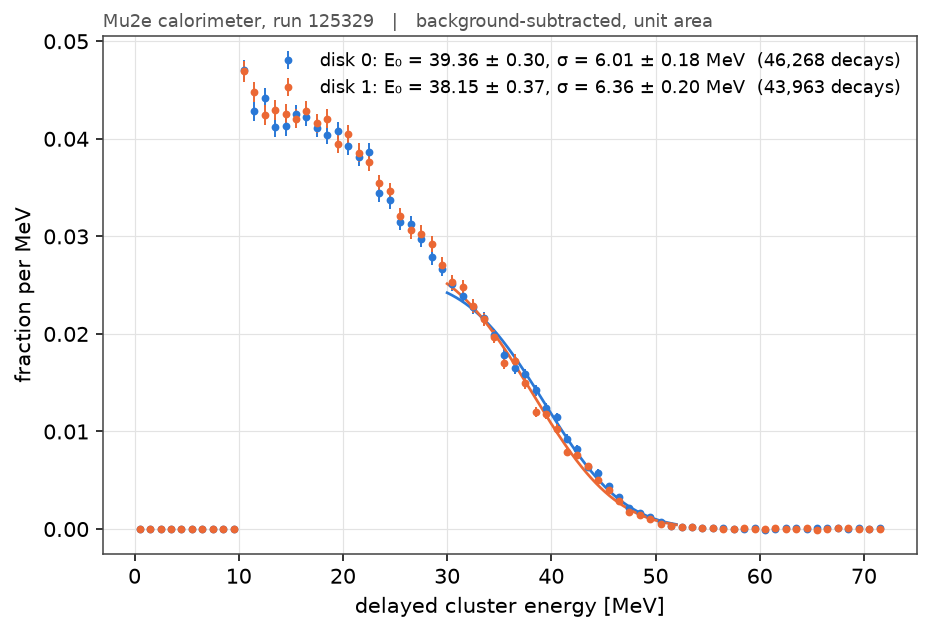

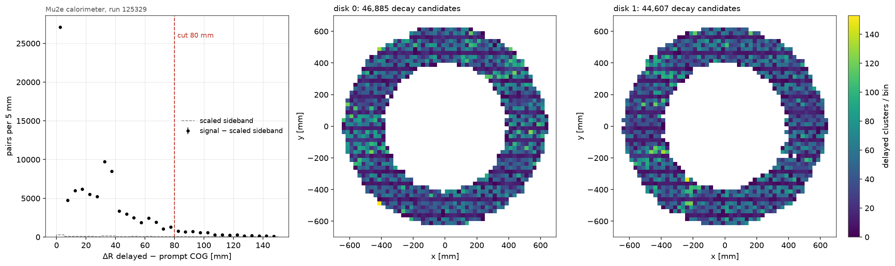

The background-subtracted spectrum rises steadily down to the 10 MeV cluster threshold, with no peak near 30 MeV. The ΔR distribution falls off well inside the 80 mm cut. Decays are spread evenly over both disks.

## 4. Event displays

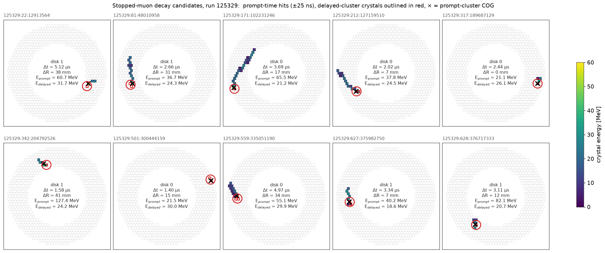

The displays show ten random decay candidates (1.25–10 µs, ΔR < 80 mm, 15 < E_d < 55 MeV), with a fixed seed so the selection is reproducible. Each shows the decay disk:

- **Muon:** hits within ±25 ns of the prompt cluster, coloured by energy.
- **Electron:** the delayed cluster's crystals, outlined in red.
- **×:** the centre of the prompt cluster.

Most show a cosmic track ending at the decay crystal.

## 5. Search for μ⁻ capture in CsI (τ ≈ 70–80 ns)

**Cluster level** ([13_capture_search.png](plots_run125329/13_capture_search.png)):

- Between the echo spikes there is a fast excess above the extrapolated μ⁺ curve, but it falls with τ ≈ 420–470 ns, not 70–80 ns, and the fitted value depends on the spike mask.
- The delayed-cluster energy shows no soft excess: capture gammas fall mostly below the 10 MeV cluster threshold.

**Hit level, uncorrected** ([14_capture_hits.png](plots_run125329/14_capture_hits.png)):

- **Method.** Each delayed hit is paired with the nearest crystal of a prompt cluster above 15 MeV and classed by distance: same crystal, adjacent, second ring, or far (200–400 mm, no capture expected).
- **Echoes.** The echo spikes appear at hit level too.
- **Adjacent vs far.** Adjacent crystals have fewer hits relative to far ones (A = −3850 ± 348 per 10 ns at τ = 75 ns).
- **Same crystal.** The excess here falls with τ ≈ 33 ns after the muon. After an echo pulse, where no capture is possible, it falls with τ ≈ 70 ns, a capture-like time constant.

**Hit level, SiPM times corrected**:

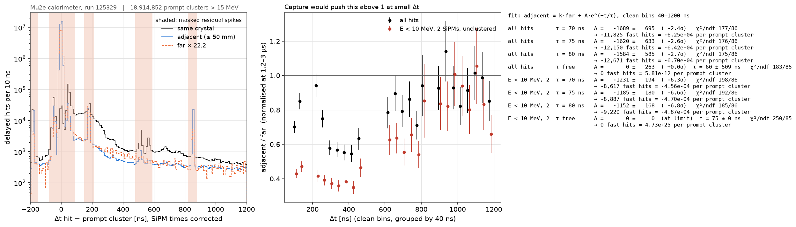

With the echoes removed, the adjacent/far ratio is still 0.35–0.6 from 100 to 500 ns. It recovers to 1 only after about 1 µs. With τ fixed to 70, 75 or 80 ns the fitted amplitude is negative: for capture-like hits (below 10 MeV, both SiPMs, not in a cluster) it is A = −1185 ± 180 at 75 ns.

Compared with the accidental rate (5–20 µs), hit rates at 100–500 ns after a muon are raised in every distance class:

| Class | All hits | E < 10 MeV, 2 SiPMs, unclustered |
|---|---|---|
| Same crystal | ×315 | ×141 |
| Adjacent | ×82 | ×71 |
| Second ring | ×79 | ×87 |
| Far (200–400 mm) | ×43 | ×82 |

A burst of mostly soft hits therefore follows every muon for about 1 µs across a whole region of the disk. For capture-like hits it is relatively *larger* in far crystals, which is why the ratio drops below 1. Physics cannot spread over 20–40 cm in under 1 µs, so an electronics effect after large pulses (crosstalk or baseline disturbance across a board) is the likely cause. This burst is far larger than any capture signal and doesn't depend on distance, so this method cannot measure capture until it is understood.

## 6. SiPM timing and gain balance

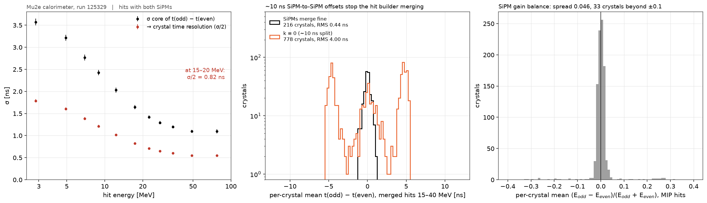

- **Time resolution.** For hits with both SiPMs, the time difference between them has a Gaussian core of σ = 3.6 ns at 2–4 MeV, falling to 1.1 ns above 40 MeV. Assuming the two SiPMs are independent and equal, the crystal time resolution is σ/2: **0.82 ns at 15–20 MeV** and 0.55 ns above 40 MeV.
- **Per-crystal offsets.** Crystals that merge correctly agree to 0.44 ns RMS. The ~10 ns-split crystals have mean offsets around ±5 ns.
- **Gain balance.** The SiPM energy asymmetry per crystal is centred at 0.002 with a spread of 0.046. 33 crystals lie beyond ±0.1.

## 7. Stability over the run

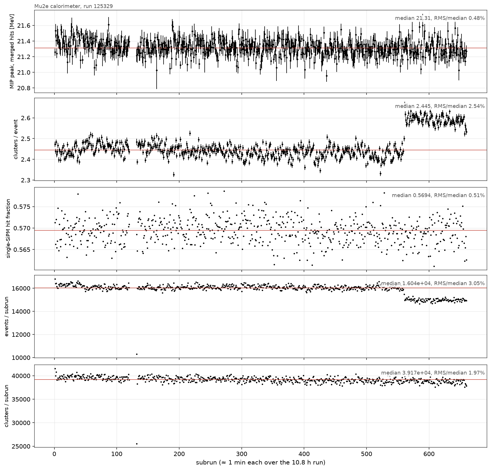

There are 649 subruns of about 1 minute.

- **Stable:** the MIP peak (21.31 MeV, 0.48% RMS) and the single-SiPM fraction (0.569, 0.5% RMS).
- **Step at subrun 561:** events per subrun drop from 16.1k to 15.0k (−7%), while clusters per subrun change by only −1% and clusters per event rise from 2.44 to 2.59. The events that disappear are mostly empty ones, so this looks like a trigger or readout change, not a change in the calorimeter.
- **Gaps:** subruns 121–131 are missing and subrun 132 is partial (10.3k events).

## 8. Cluster and crystal QA

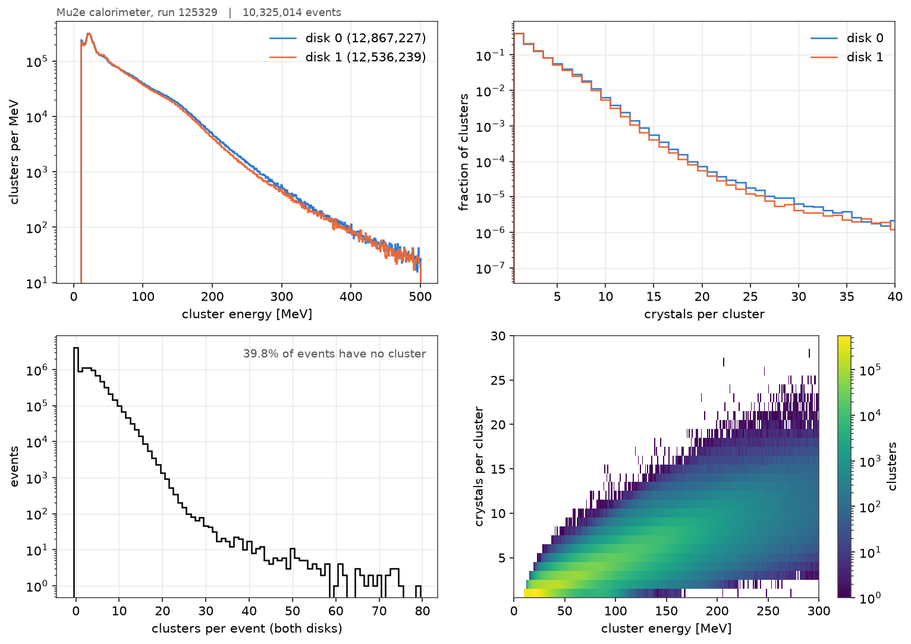

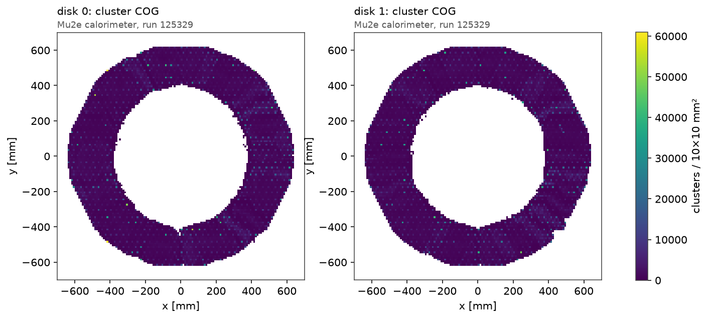

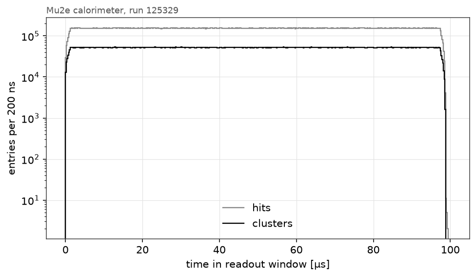

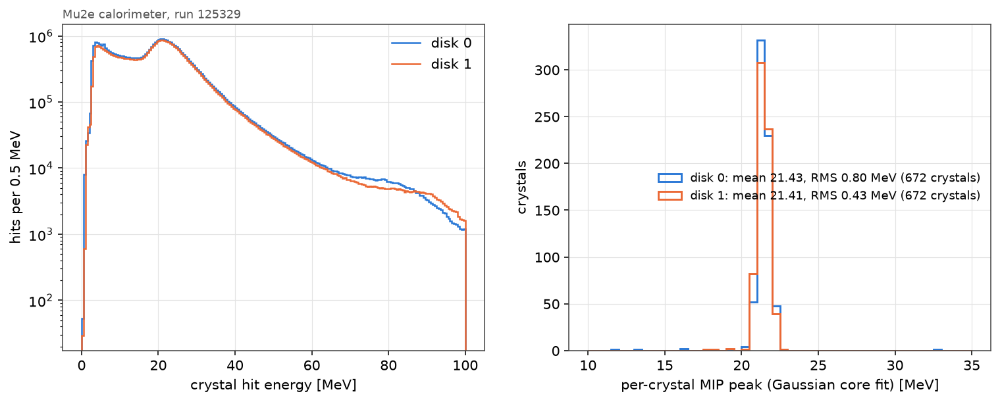

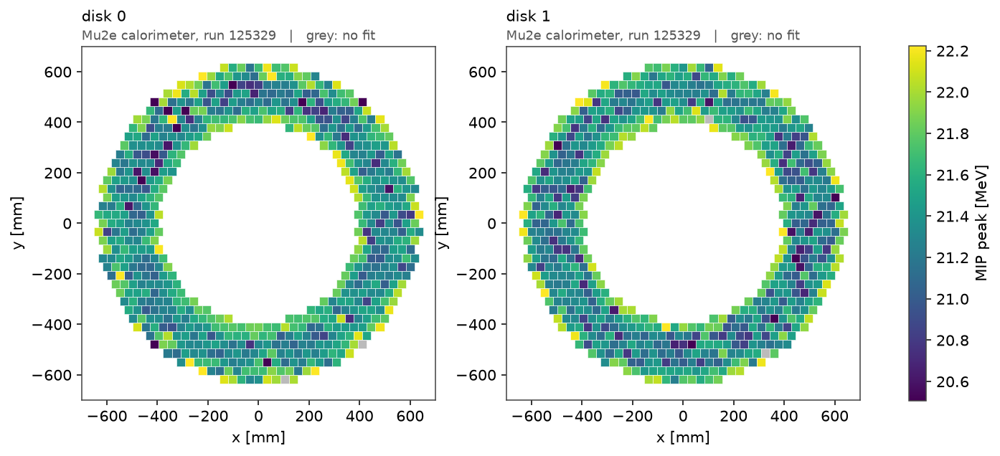

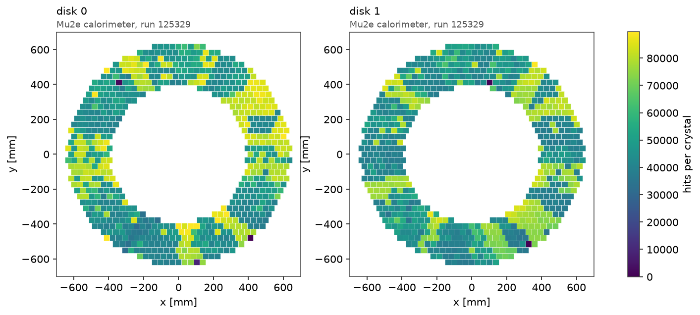

- **Clusters.** Disk 0 has 12.87M and disk 1 12.54M, with matching energy and size spectra. 39.8% of events have no cluster.
- **MIP peak per crystal.** Fitted in 1344 of 1348 crystals: 21.42 MeV on average, with a 0.64 MeV (3%) spread. Crystals on the edges come out somewhat higher, probably because cosmics cross them along different paths. This checks the existing MIP calibration rather than measuring it independently.

## 9. Stopped muons from corrected hit tracks (calorimeter only, no MC)

[fill_stops.py](fill_stops.py) builds tracks from hits, not reco clusters, after removing the per-SiPM time offsets of section 1. A track is a set of hits on one disk chained in time with gaps under 30 ns. This matters for two reasons:

- The clustering splits one cosmic into several same-time clusters: 21% of clusters above 15 MeV have a partner on the same disk within 30 ns.
- A crystal with a shifted SiPM drops out of the track.

Either effect makes the track seem to end early, so the Michel shows up "ahead" of the supposed stop. Before the fix, the up/down Michel asymmetry was −0.69.

The stop is the lowest end of a muon track (above 15 MeV) with no earlier muon on that disk within 25 µs and 150 mm. Of 6.53M candidates, 4.2M are in the time window.

### Stop purity

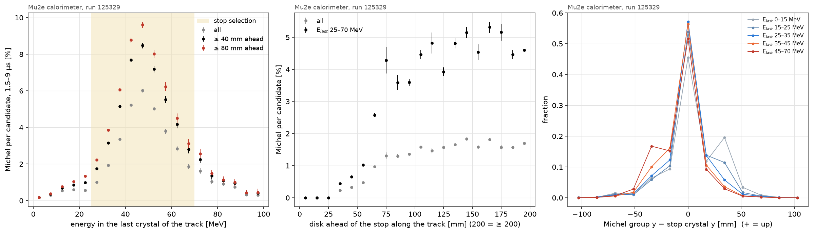

The calorimeter can't see a muon leave through a disk face, so most track endpoints are not stops. The Michel rate (1.5–9 µs) per candidate is 0.4% at low last-crystal energy and peaks at 7–8% for 40–50 MeV (Bragg peak) with ≥ 80 mm of disk ahead.

- **Stop sample:** E_last 25–70 MeV, ≥ 40 mm ahead, 662k candidates.
- **Michel content:** 3.7% per candidate. Dividing by the window efficiency gives 7.6%, so with f(μ⁺) ≈ 0.55 only about 14% of candidates are real stops.
- **Charge ratio:** the purity can't be measured independently, so the μ⁺/μ⁻ ratio isn't accessible from the calorimeter alone. A stop definition from the tracker or CRV is needed.

### Lifetime

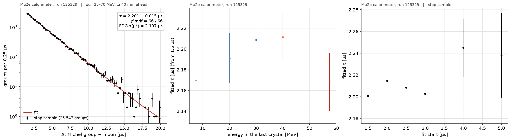

**τ = 2.201 ± 0.015 µs** (χ²/ndf 66/66, from 1.5 µs), consistent with PDG 2.197 µs. It is the same in every E_last bin and does not depend on the fit start.

The low τ of section 2 most likely comes from the cluster-pair method (track fragments and echoes as prompts). Even the low-E_last classes, which hold the most non-CsI stops, give 2.16–2.18 ± 0.03 µs, so there's no sign of a light-material component. The clock scale is fine.

### Michel deposit spectrum below the cluster threshold

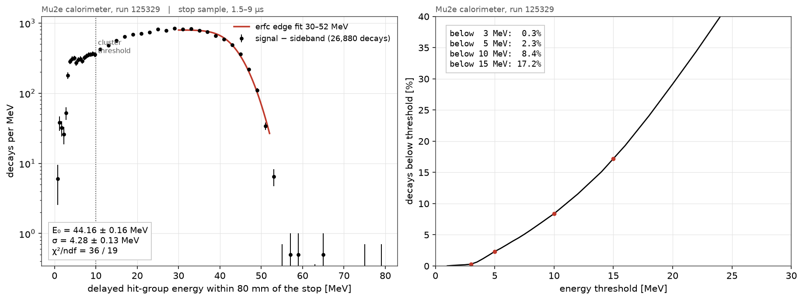

Hit groups within 80 mm of the stop reach down to 0.5 MeV:

| Threshold | Michel decays below it |
|---|---|
| 3 MeV | 0.3% |
| 5 MeV | 2.3% |
| 10 MeV (cluster threshold) | 8.4% |

So a 10 MeV cluster threshold loses 8% of decays.

### Up/down asymmetry (polarization)

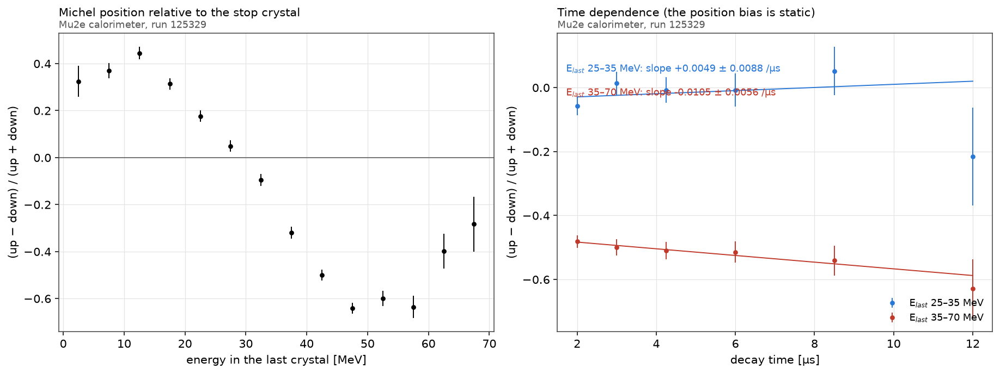

The asymmetry is not measurable here. The stop is located only to about one crystal, and the error lies along the muon direction, which is the polarization axis. The Michel position relative to the stop crystal swings with E_last:

- **Low E_last** (the endpoint is a soft extra hit): +0.4.
- **E_last 25–35 MeV:** about 0.
- **High E_last** (the muon continues below without a counted hit): −0.6.

The bias is static, so a spin-relaxation effect would still show as a time dependence. The fitted slopes are +0.005 ± 0.009 /µs (25–35 MeV) and −0.011 ± 0.006 /µs (35–70 MeV): no significant effect.

### Delayed soft activity (neutron-capture gammas)

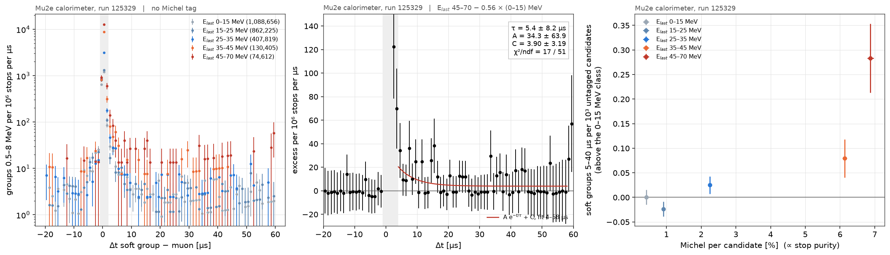

Candidates with no Michel tag (no group > 3 MeV within 80 mm in 0.1–25 µs) are compared by purity class:

- **Measure:** soft hit groups (0.5–8 MeV, within 150 mm). The live time accounts for the readout window and vetoes ±3 µs around any group above 10 MeV.
- **Hint of a signal:** above the least pure class, the 5–40 µs excess grows with stop purity, reaching 0.20 ± 0.06 per 10³ candidates in the purest class (about 3σ).
- **Time constant:** not measured; the fit gives τ = 5 ± 8 µs. About 3× more data, or a purer stop sample, is needed.

### μ⁻ capture in the stop crystal's waveform

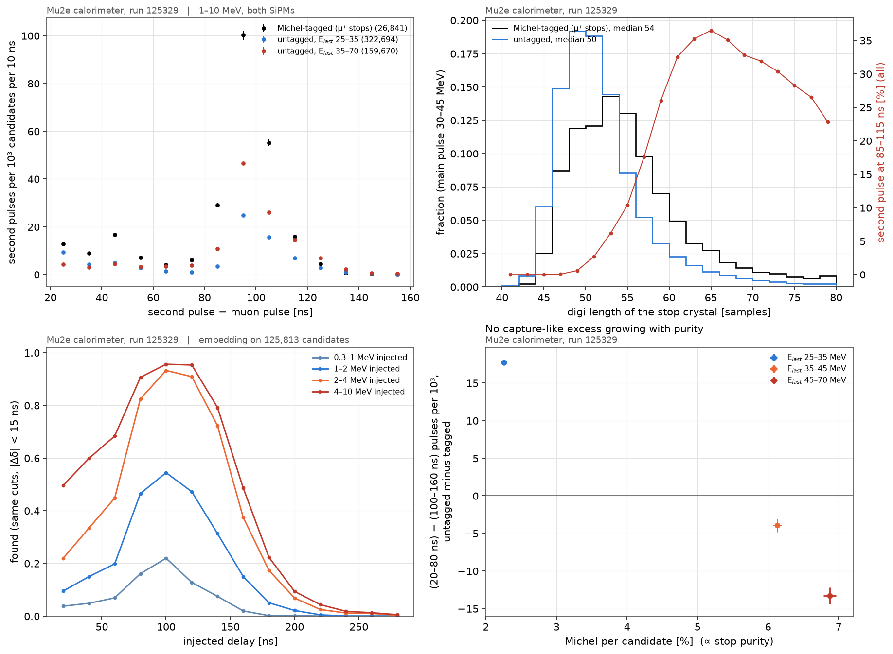

**Why the hit-level search (section 5) couldn't work.** A pulse is about 150 ns FWHM, and the reconstruction makes one recodigi per digi (1.004 on average). A capture deposit 20–150 ns after the muon, in the same crystal, sits inside the muon's own digi and never becomes a hit.

**Method.** [fill_wfcapture.py](fill_wfcapture.py) works in raw digitizer time, so the SiPM offsets don't enter:

- It fits both SiPMs of the stop crystal with a data template ([wf_template.py](wf_template.py)).
- The main pulse gets free T′ and T″ terms; the second pulse is scanned in delay.
- Embedding measures the efficiency: above 80% for 2–10 MeV at 80–140 ns, about 50% at 20–40 ns. Beyond about 150 ns the digi has ended.

**Result: no capture signal.** Every class shows "second pulses" at 85–115 ns. They depend almost only on digi length: 0 below 45 samples, about 25–35% above 60.

**A new observation.** At equal main-pulse energy, Michel-tagged μ⁺ stops have longer digis than the untagged sample, which is mostly muons passing through (median 54 vs 50 samples). So stopping-muon pulses differ in shape. One possible cause is ionisation-density (Bragg peak) dependence of the CsI light, but this isn't established.

As a result, μ⁺ stops are not a valid background template for an untagged sample that is about 86% through-going: untagged − tagged is negative and falls with purity. A capture measurement needs a cleaner μ⁻ stop sample (tracker/CRV) or a pulse-shape model that includes the stop/through-going difference.

## Comparison with the 22/10/26 slides

| | This study | Slides |
|---|---|---|
| τ | 2.117 ± 0.008 µs (from 1.25 µs) | 2.175 ± 0.009 µs (from 1 µs) |
| Michel E₀ / σ | 38.80 ± 0.23 / 6.18 ± 0.13 MeV | 42.80 ± 0.12 / 5.13 ± 0.10 MeV |

The slide's Michel spectrum goes down to about 4 MeV and peaks near 30 MeV, so it used a different clustering threshold or energy reconstruction. The difference in τ is about the size of its dependence on the fit start.

## Open items

- **SiPM calibration.** Check [sipm_abs_offsets_run125329_shifted.txt](sipm_abs_offsets_run125329_shifted.txt) against the calibration database and the readout-board map. Fix the per-SiPM time constants and the hit builder's merge window, then reprocess.
- **Post-muon burst.** Understand the ~1 µs burst of soft hits after a muon. Look at `calodigis` waveforms in far crystals after a large pulse, and check whether the excess follows readout-board boundaries.
- **Capture.** Hits can't see it (section 9). The waveform search needs a purer μ⁻ stop sample (tracker/CRV), and the pulse-shape difference between stopping and through-going muons must be understood.
- **Clustering.** Cosmic tracks are split into several same-time clusters (section 9); check the clustering time window against the SiPM offsets.
- **Stop definition.** Matching to the tracker or CRV would fix the purity. That is needed for the charge ratio and a real neutron measurement.
- **Run conditions.** Check the run log for the trigger change at subrun 561 and the missing subruns 121–131.
